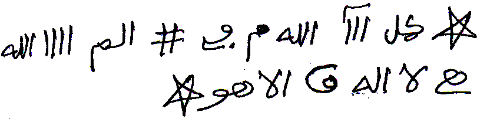

# TERJEMAHAN LENGKAP + TRANSLITERASI — الأسماء الطمطمية

**Edisi:** Terjemahan Indonesia menyeluruh + alih aksara Latin, **kecuali wafaq**.
**Sumber:** `TRANSKRIPSI_ASMAK_THOMTHOMIYAH_LENGKAP.md` (12 halaman, 5 November 2026).
**Disusun:** Ustadz Yoad · **Tanggal permintaan:** 5 November 2026.

---

## A. Kedudukan edisi ini — pembatasan aturan yang dicatat

> **Ini edisi tersendiri, BUKAN perubahan pada transkrip master.** Kunci permanen
> `KUNCI_PERMANEN_USTADZ_YOAD.md` §4.1–§4.2 memerintahkan menjaga azimah/asma'/thilasm
> dan **tidak menerjemahkannya**. Pemilik kitab pada 5 November 2026 memberi perintah
> eksplisit: *"Terjemahkan secara lengkap terkecuali wafaknya, terjemahan bahasa Indonesia dan translite nya."*
> Perintah itu **mengecualikan berkas ini** dari
> larangan tersebut. `TRANSKRIPSI_ASMAK_THOMTHOMIYAH_LENGKAP.md` tetap berstatus
> **Muhafazhah** dan tidak disentuh; penanda `[TEKS ASLI DIJAGA ...]` di sana tetap utuh.

**Yang dilakukan di sini:**

1. Seluruh teks Arab yang **bermakna** (muqaddimah, basmalah, shalawat, kaifiyat 14
   khātam, keterangan, jadwal hari/waktu, doa penutup, kutipan ayat) diberi
   **transliterasi Latin** dan **terjemahan Indonesia**.
2. **Wafaq dikecualikan sepenuhnya**: 15 kotak ٣×٣, seluruh angka Arab-Indik di dalamnya, dan label sel tengahnya **tidak diterjemahkan, tidak ditransliterasi, tidak diubah**. Lihat Lampiran F.
3. Asma', azimah, dan `الاسم الكبير` tetap ditampilkan dalam huruf Arab sebagai
   rujukan mengikat, diberi **transliterasi**, dan diberi **keterangan Indonesia**.
   Lihat §C tentang mengapa lafaz itu tidak punya "arti" harfiah.
4. Klaim khasiat/perkara gaib selalu ditulis sebagai **pernyataan naskah**, bukan
   fakta medis, bukan anjuran amal, bukan jaminan hasil. Penelaahan ahli bahasa Arab
   dan ahli fiqh tetap diperlukan sebelum penerbitan.

---

## B. Skema transliterasi yang dinyatakan (bukan alih aksara sembarangan)

| Lapis | Skema | Contoh |
|---|---|---|
| **Prose Arab biasa** | Fusha baku: `ā ī ū`, hamzah `ʾ`, `ʿ` = ع, `ḥ ṣ ḍ ṭ ẓ`, `gh sy kh dh ts`, `q j w y`; `ال-` → `al-` dengan asimilasi huruf syamsiah (`ar-Raḥmān`, `as-Sayyid`, `ath-Thamthamiyyah`). | `بسم الله` → *Bismillāh* |
| **Asma' / azimah / kunci** | Skema mekanis §1A master: peta huruf tanpa vokal + ejaan bantu (`ṭ-m-ṭ-k-…`, `ṭasyar mawsyasy`). Dipakai apa adanya agar konsisten dengan edisi sebelumnya. | `طشر موشش` → `ṭasyar mawsyasy` |
| **Angka** | Tetap Arab-Indik; **tidak ditransliterasi**. Nomor kontak dan bilangan hitungan bukan wafaq, tetapi tetap ditulis sebagaimana naskah. | `٧٨٧`, `٨٧`, `٣١٣` |

> **Vokal adalah ijtihad bantu.** Naskah aslinya **gundul** (tanpa tasykīl). Harakat
> pada transliterasi prose di bawah adalah **asumsi bacaan konvensional**, bukan
> harakat naskah, bukan pensahihan bacaan, dan bukan ijazah. Rasm penyimpang
> (`ألان`, `كذالك`, `فانه`, `يقرا`, `اله`, `ليله`, `تجرى`, `احمر`, `ذالك`, `ابد`,
> `الجلجلوتيه`, dll.) **dipertahankan** pada kolom Arab; transliterasi mengikuti
> bacaan yang paling dekat dan diberi catatan. Untuk amal, wirid, atau ijazah,
> rujuklah **lafaz Arab** dan guru yang berijazah.

---

## C. Catatan kejujuran filologis tentang asma' (Pakar Nahwu Sharaf)

Asma' seperti `طشر موشش`, `طمطكطجيشمحمدأل`, `تبخ بخ بخ هيسون`, dan `دلدل طد ندكم`
**bukan kalam Arab yang bertasrif**: ia tidak punya akar (مادة) yang dikenal dalam
`الصرف`, tidak dapat ditentukan `وزن`-nya, tidak ada isim/fi'il/harf di dalamnya, dan
tidak ditemukan padanan makna leksikalnya. Memberi "arti" baginya berarti `تأويل بلا دليل` — mengarang makna tanpa dalil. Maka pada kolom **Terjemah Indonesia** untuk
lafaz semacam ini saya beri **keterangan fungsional yang jujur**: "asma' ke-N, lafaz
non-leksikal, dilafalkan apa adanya", plus keterangan posisinya di naskah. Itulah
terjemahan yang dapat dipertanggungjawabkan secara ilmiah.

**Pengecualian yang dapat dibaca:** di dalam `طمطكطجيشمحمدأل` terbaca jelas `محمد`
(= *Muhammad*). Sisanya tetap non-leksikal. Ini dicatat, tidak diperluas menjadi
tafsir nama.

`الـ` pada akhir `...أل` dan hamzah `أ` dibaca sesuai rasm; tidak saya "betulkan"
menjadi `الله` atau `آل`, karena itu akan mengubah lafaz.

---

## D. Kamus istilah (kunci permanen §4.4 — Istilah Falak/Hikmah)

| Istilah | Perlakuan dalam terjemahan |
|---|---|
| `خاتم` | Tetap **khatam** — Istilah Falak/Hikmah, bukan diterjemahkan bebas jadi "cincin/penutup" |
| `وفق`, `طلسم`, `توكيل`, `خادم` | Tetap **wafaq, thilasm, tawkiil, khadim** — Istilah Falak/Hikmah |
| `بخور` | **Bukhur / diasapi** — Istilah Falak/Hikmah (bukan sekadar "dupa") |
| `زحل، مشتري، عطارد` | Nama planet — Istilah Falak/Hikmah; tidak muncul di naskah ini, tetap dicatat |
| `حرز` | **Hirz** (jimat pelindung) — istilah teknis |
| `تسخير` | **Taskhir** (penundukan) — istilah teknis |
| `الجلجلوتيه` | **al-Jaljaluutiyyah** — nama kitab/rubrik ruhani, dengan ه sesuai rasm |
| `السليمانى`, `آصف بن برخيا` | **Sulaimani**, **Asaf ibn Barkhiya** — nisbah/nama tokoh |
| `الـــى` | Penanda naskah untuk *ilā* = "sampai kepada (firman …)" pada kutipan ayat terpotong |

Kutipan Al-Qur'an di naskah **sering tidak lengkap** dan memakai rasm sendiri;
terjemahan di bawah menerjemahkan **bagian yang dikutip**, dengan tanda "… sampai …",
bukan melengkapi ayat dari mushaf.

---

## E. Terjemahan per halaman

### HAL 01 — Sampul / Muqaddimah

| No | Teks Arab | Transliterasi | Terjemah Indonesia |
|---|---|---|---|
| 1.1 | `شيخ الروحانيين الشيخ عطية عبد الحميد للمتابعة والكشف الروحاني` | *Shaykh ar-rūḥāniyyīn, ash-Shaykh ʿAṭiyyah ʿAbd al-Ḥamīd, li-l-mutābaʿati wa-l-kashfi ar-rūḥānī* | "Syaikhnya para ahli ruhani, Syaikh Athiyyah Abd al-Hamid — untuk pemantauan dan kasyf ruhani." Baris biru-hitam: identitas/iklan penyusun. |
| 1.2 | `٠٠٢٠١٠٦٢٠٢٢٢٣٨` | — (bilangan, bukan lafaz; tidak ditransliterasi) | Nomor kontak penyusun. Bukan angka wafaq, tetap ditulis Arab-Indik sebagaimana tampil di halaman. |
| 1.3 | `الأسماء الطمطمية أسماء آصف ابن برخيا وكيفية العمل بيها` | *al-Asmā' ath-Thamthamiyyah: asmā' Āṣaf ibn Barkhiyā wa-kayfiyyat al-ʿamali bihā* | "Asma' ath-Thamthamiyyah: nama-nama Asaf ibn Barkhiya dan tata cara mengamalkannya." Judul merah. `بيها` = `بها` sesuai rasm. |
| 1.4 | `بسم الله الملك الحق المبين الرحمن الرحيم` | *Bismillāhi al-Maliki al-Ḥaqqi al-Mubīni ar-Raḥmāni ar-Raḥīm* | "Dengan nama Allah, Sang Raja, Yang Maha Benar, Yang Maha Menjelaskan, Maha Pengasih lagi Maha Penyayang." |
| 1.5 | `اللهم صلى على سيدنا محمد الحبيب المحبوب شافي العلل ومفرج الكروب وعلى اله وصحبه وسلم صلاة ترضيك يا الله وترضية وترضى بها عنى يا رب العالمين آمين آمين آمين` | *Allāhumma ṣalli ʿalā Sayyidinā Muḥammadin al-Ḥabībi al-Maḥbūbi, Syāfī al-ʿilali wa-mufarriji al-kurūbi, wa-ʿalā ālihi wa-ṣaḥbihi wa-sallim, ṣalātan tarḍāka yā Allāh, wa-tarḍiyatan wa-tarḍā bihā ʿannī, yā Rabba al-ʿālamīn. Āmīn, āmīn, āmīn.* | "Ya Allah, limpahkanlah shalawat kepada junjungan kami Muhammad, sang Kekasih yang dicintai, Penyembuh segala penyakit dan Pelapang segala kesusahan, serta kepada keluarga dan para sahabatnya; sampaikanlah pula salam — shalawat yang Engkau ridai, wahai Allah, dan yang dengannya Engkau berkenan meridai aku, wahai Tuhan semesta alam. Amin, amin, amin." Rasm `صلى` dibaca `ṣalli`, `اله` dibaca `ālihi`, `ترضية` samar; vokal di atas ijtihad bantu. |
| 1.6 | `هذه الأسماء لها أسرار عظيمة ومجربة من مجرباتي شيخ الروحانيين الشيخ عطية عبد الحميد وأحببت أن أضعها لكل محبي هذا العلم حتى لا يبخل علينا بالدعاء وهذه الأسماء خاصة بالسيد اصف ابن برخيا وسميت باسم أسماء اصف وها هي بين أيديكم ألان` | *Hādhihi al-asmā'u lahā asrārun ʿaẓīmatun wa-mujarrabatun min mujarrabātī, Shaykhu ar-rūḥāniyyīn ash-Shaykh ʿAṭiyyah ʿAbd al-Ḥamīd, wa-aḥbabtu an aḍaʿahā li-kulli muḥibbī hādhā al-ʿilmi ḥattā lā yabkhala ʿalaynā bi-ad-duʿā'i, wa-hādhihi al-asmā'u khāṣṣatun bi-as-Sayyidi Āṣaf ibn Barkhiyā wa-sumiyyat bi-ismi "Asmā' Āṣaf", wa-hā hiya bayna aydīkum al-ān.* | "Nama-nama ini memiliki rahasia-rahasia yang agung dan sudah teruji, termasuk dari uji coba saya sendiri, Syaikh para ahli ruhani, Syaikh Athiyyah Abd al-Hamid. Aku ingin meletakkannya bagi setiap pencinta ilmu ini, supaya mereka tidak kikir mendoakan kami. Nama-nama ini khusus bagi Sayyid Asaf ibn Barkhiya dan dinamai 'Asma' Asaf'; dan inilah ia sekarang berada di hadapan kalian." `ألان` = `الآن`, `اصف` = `آصف` (rasm dipertahankan). |
| 1.7 | `الأسماء الطمطمية` | *al-Asmā' ath-Thamthamiyyah* | "Asma' ath-Thamthamiyyah." Judul merah pengantar kaifiyat umum. Ejaan populer "thomthomiyah" pada nama berkas bukan rujukan lafaz. |
| 1.8 | `هذه هي الأسماء الطمطمية عظيمة جدا فمن أراد أن يحبه الناس ويوقروه ويبجلوه ويعظموه ويسمعوا كلامه ويطيعوا أوامره فليكتب الخاتم السليمانى ويكتب حوله الأسماء كلها مرة والاسم الكبير ٨٧ مرة ويمحيها ويغسل بيه وجهه وكبه في ماء شربهم أو في مأكلهم فانه يكون بإذن الله تعالى وهذا الخاتم` | *Hādhihi hiya al-asmā'u ath-Thamthamiyyatu ʿaẓīmatun jiddan. Fa-man arāda an yuḥibbahu an-nāsu wa-yuwaqqirūhu wa-yubajjilūhu wa-yuʿaẓẓimūhu wa-yasmaʿū kalāmahu wa-yuṭīʿū awāmirahu, fa-l-yaktub al-Khātam as-Sulaymānī, wa-yaktub ḥawlahu al-asmā'a kullahā marratan wa-al-Ism al-Kabīra 87 marratan, wa-yamḥūhā wa-yaghsil bihi wajhahu wa-yakubbahu fī mā'i syurbihim aw fī ma'kalihim, fa-innahu yakūnu bi-idhni Allāhi taʿālā. Wa-hādhā al-Khātam.* | "Inilah Asma' ath-Thamthamiyyah, sangat agung. Maka barangsiapa menghendaki orang-orang mencintainya, memuliakannya, mengagung-agungkannya, mendengarkan ucapannya, dan menaati perintah-perintahnya, hendaklah ia menuliskan Khatam Sulaimani, menuliskan seluruh asma' di sekelilingnya satu kali dan al-Ism al-Kabir 87 kali, lalu menghapusnya, membasuh wajahnya dengannya, dan menuangkannya ke dalam air minum mereka atau makanan mereka; maka — menurut klaim naskah — hal itu terjadi dengan izin Allah Ta'ala. Dan inilah khatamnya." `فانه` = `فإنه`, `بيه` = `به` (rasm dipertahankan). |

### HAL 02 — Daftar Asma'

| No | Teks Arab | Transliterasi | Terjemah Indonesia |
|---|---|---|---|
| 2.0 | Thilasm tulis tangan (gambar) | — (tidak ada teks terbaca) | Gambar rajah di kepala halaman. Tidak ada huruf Arab yang dapat dibaca dengan pasti, sehingga **tidak ada yang dapat ditransliterasi atau diterjemahkan**; bukan wafaq, tetap dijaga sebagai facsimile. |
| 2.1 | `والاسم الكبير هو هذا` | *Wa-al-Ismu al-Kabīru huwa hādhā* | "Dan inilah al-Ism al-Kabir (Nama Agung)." |
| 2.2 | `طمطكطجيشمحمدأل` | `ṭamaṭakaṭajaysyamaḥamadaʾl` (peta: `ṭ-m-ṭ-k-ṭ-j-y-sy-m-ḥ-m-d-ʾ-l`) | Lafaz kunci 14 huruf. Di dalamnya terbaca `محمد` = "Muhammad"; selebihnya bukan kalam Arab bermakna sehingga tidak ada terjemahan harfiah. Dilafalkan apa adanya; **bukan pensahihan bacaan**. |
| 2.3 | `والأسماء الأربعة عشر هي هذه` | *Wa-al-asmā'u al-arbaʿata ʿasyara hiya hādhihi* | "Dan keempat belas asma' itu adalah sebagai berikut." |
| 2.4 | `تمت بحمد الله وعونه` | *Tammat bi-ḥamdi Allāhi wa-ʿawnihi* | "Selesailah, dengan puji kepada Allah dan pertolongan-Nya." Penutup daftar. |
| 2.5 | `واليك جداولها وكلها صحيحة الوضع` | *Wa-ilayka jadāwiluhā wa-kulluhā ṣaḥīḥatu al-waḍʿi* | "Dan kepadamu (diberikan) tabel-tabelnya; semuanya sahih penempatannya — menurut pernyataan naskah." `واليك` = `وإليك`. |

**Daftar 14 asma' (hal. 02).** Angka ١–١٤ adalah nomor urut daftar, **bukan angka wafaq**.

| No | Lafaz Arab (mengikat) | Transliterasi (§1A) | Terjemah Indonesia |
|---|---|---|---|
| ١ | `طشر موشش` | `ṭasyar mawsyasy` | Asma' pertama — lafaz non-leksikal, tidak ada makna harfiah; dilafalkan apa adanya. Dipakai pada khatam no. 1. |
| ٢ | `مهرش الش` | `maharasy al-sy` | Asma' kedua — non-leksikal; dipakai pada khatam no. 2. |
| ٣ | `طفطنطفش` | `ṭafaṭanaṭafasy` | Asma' ketiga — non-leksikal; dipakai pada khatam no. 3. |
| ٤ | `كويش ظرخ` | `kawyasy ẓarakh` | Asma' keempat — non-leksikal; dipakai pada khatam no. 4. |
| ٥ | `طمخ طميخ` | `ṭamakh ṭamaykh` | Asma' kelima — non-leksikal; dipakai pada khatam no. 5. |
| ٦ | `جفنض لمخ` | `jafanaḍ lamakh` | Asma' keenam — non-leksikal; dipakai pada khatam no. 6. Varian hal. 05/06: `جفض لمخ`. |
| ٧ | `يرة بزيخ` | `yaraah bazaykh` | Asma' ketujuh — non-leksikal; dipakai pada khatam no. 7. Varian hal. 06: `يرة بريخ`. |
| ٨ | `شوكج بجخ` | `syawkaj bajakh` | Asma' kedelapan — non-leksikal; dipakai pada khatam no. 8. |
| ٩ | `مذطص جبخ` | `madhaṭaṣ jabakh` | Asma' kesembilan — non-leksikal; dipakai pada khatam no. 9. Varian hal. 07/12: `مذطص جفخ`. |
| ١٠ | `حشتم دمخ` | `ḥasyatam damakh` | Asma' kesepuluh — non-leksikal; dipakai pada khatam no. 10. |
| ١١ | `مظهر شمخ` | `maẓahar syamakh` | Asma' kesebelas — non-leksikal; dipakai pada khatam no. 11. |
| ١٢ | `ديوم شلش` | `daywam syalasy` | Asma' kedua belas — non-leksikal; dipakai pada khatam no. 12. |
| ١٣ | `ارخ شمرخ` | `ʾarakh syamarakh` | Asma' ketiga belas — non-leksikal; dipakai pada khatam no. 13. |
| ١٤ | `لمخ شدمخ` | `lamakh syadamakh` | Asma' keempat belas — non-leksikal; dipakai pada khatam no. 14. Varian hal. 10: `لنخ شدمخ`. |

### HAL 03 — Khatam 1 · Khatam 2

| No | Teks Arab | Transliterasi | Terjemah Indonesia |
|---|---|---|---|
| 3.1 | `خاتم الاسم الأول` | *Khātam al-Ism al-Awwal* | "Khatam asma' pertama." Judul merah. `خاتم` = Istilah Falak/Hikmah. |
| 3.2 | `طشر موشش` | `ṭasyar mawsyasy` | Asma' ke-1, lafaz non-leksikal; dilafalkan apa adanya. |
| 3.3 | `يذكر عدد ٧٨٧ مع الم الله لا اله إلا هو عدد ٧٧ على ماء ويرش به وجه المريض فيبرا حينه إن شاء الله` | *Yudhkaru ʿadadu 787 maʿa "Alif-Lām-Mīm, Allāhu lā ilāha illā Huwa" ʿadada 77 ʿalā mā'in, wa-yurashshu bihi wajhu al-marīḍi fa-yabra'u ḥīnahu in syā'a Allāh* | "Dizikirkan sebanyak 787 bersama 'Alif Lām Mīm; Allah, tiada Tuhan selain Dia' sebanyak 77 kali di atas air, lalu dipercikkan ke wajah orang sakit; menurut naskah ia sembuh saat itu juga, insyaAllah." Kutipan ringkas Q.S. Ali 'Imran 3:1–2; naskah menulis `الم الله لا اله إلا هو`. |
| W1 | وفق ٣×٣ no. 1 | — | **[DIKECUALIKAN — WAFAQ]** Tidak diterjemahkan, tidak ditransliterasi. Lihat Lampiran F. |
| 3.4 | `خاتم الاسم الثاني` | *Khātam al-Ism ath-Thānī* | "Khatam asma' kedua." |
| 3.5 | `مهرش الش` | `maharasy al-sy` | Asma' ke-2, non-leksikal. |
| 3.6 | `يذكر عدد ٧٧ مرة مع الم الله لا اله إلا هو ٨٢٨ لكل حاجة تقضى بإذن الله` | *Yudhkaru ʿadadu 77 marratan maʿa "Alif-Lām-Mīm, Allāhu lā ilāha illā Huwa" 828 li-kulli ḥājatin tuqḍā bi-idhni Allāh* | "Dizikirkan 77 kali bersama 'Alif Lām Mīm; Allah, tiada Tuhan selain Dia' dan bilangan 828, untuk setiap hajat yang dipenuhi dengan izin Allah." |
| W2 | وفق ٣×٣ no. 2 | — | **[DIKECUALIKAN — WAFAQ]** Baris ketiganya secara fisik tercetak di hal. 04; lihat Lampiran F. |

### HAL 04 — Khatam 3 · Khatam 4

| No | Teks Arab | Transliterasi | Terjemah Indonesia |
|---|---|---|---|
| 4.0 | `٢٢٧٠ ٤ ٢` | — (angka wafaq) | **[DIKECUALIKAN — WAFAQ]** Lanjutan baris ke-3 wafaq no. 2; sudah disajikan lengkap di Lampiran F. |
| 4.1 | `خاتم الاسم الثالث` | *Khātam al-Ism ath-Thālith* | "Khatam asma' ketiga." |
| 4.2 | `طفطنطفش` | `ṭafaṭanaṭafasy` | Asma' ke-3, non-leksikal. |
| 4.3 | `يذكر بدون عدد لرد الضالة أو المسروق مع كتابه اسم الضالة وسط الخاتم حرز يوضع في المحل` | *Yudhkaru bidūni ʿadadin li-raddi aḍ-ḍāllati aw al-masrūqi, maʿa kitābi ismi aḍ-ḍāllati wasaṭa al-khātami, ḥirzun yūḍaʿu fī al-maḥalli* | "Dibaca tanpa hitungan tertentu untuk mengembalikan barang hilang atau curi, dengan menuliskan nama barang yang hilang itu di tengah khatam, sebagai **hirz** yang diletakkan di tempatnya." `حرز`, `خاتم` = istilah teknis. |
| W3 | وفق ٣×٣ no. 3 | — | **[DIKECUALIKAN — WAFAQ]** Lihat Lampiran F. |
| 4.4 | `خاتم الاسم الرابع` | *Khātam al-Ism ar-Rābiʿ* | "Khatam asma' keempat." |
| 4.5 | `كويش ظرخ` | `kawyasy ẓarakh` | Asma' ke-4, non-leksikal. |
| 4.6 | `يذكر عدد ٤١ مع الفاتحة كذالك على مجنون ثلاث أيام مع كتابه الخاتم حرز يتبخر به ثلاث ليالي يبرا بحول الله وقوته` | *Yudhkaru ʿadadu 41 maʿa al-Fātiḥati, kadhālika ʿalā majnūnin thalāthata ayyāmin, maʿa kitābati al-khātami ḥirzan yutabakhkharu bihi thalātha layālin, fa-yabra'u bi-ḥawli Allāhi wa-quwwatihi* | "Dibaca 41 kali bersama al-Fatihah; demikian pula untuk orang gila selama tiga hari, dengan menuliskan khatam itu sebagai **hirz**, lalu **diasapi (bukhur)** dengannya selama tiga malam; menurut naskah ia sembuh dengan daya dan kekuatan Allah." `كذالك` = `كذلك`. |
| W4 | وفق ٣×٣ no. 4 | — | **[DIKECUALIKAN — WAFAQ]** Baris ketiga tercetak di hal. 05; lihat Lampiran F. |

### HAL 05 — Khatam 5 · Khatam 6

| No | Teks Arab | Transliterasi | Terjemah Indonesia |
|---|---|---|---|
| 5.0 | `٢٦٣٠ ٤ ٢` | — (angka wafaq) | **[DIKECUALIKAN — WAFAQ]** Lanjutan baris ke-3 wafaq no. 4. |
| 5.1 | `خاتم الاسم الخامس` | *Khātam al-Ism al-Khāmis* | "Khatam asma' kelima." |
| 5.2 | `طمخ طميخ` | `ṭamakh ṭamaykh` | Asma' ke-5, non-leksikal. |
| 5.3 | `يقرا بعد ما كتب عليها هذه الأحرف` | *Yuqra'u baʿda mā kutiba ʿalayhā hādhihi al-aḥruf* | "Dibaca setelah dituliskan padanya huruf-huruf ini." `يقرا` = `يقرأ` (rasm dipertahankan). |
| 5.4 | `دلدل طد ندكم` | `daladal ṭad nadakam` | Azimah/huruf tambahan, lafaz non-leksikal; tidak ada terjemahan harfiah, dilafalkan apa adanya. |
| 5.5 | `مع كتابه الخاتم واسمه في الوسط فيبخر به ثلاث ليال فيبرأ إن شاء الله` | *Maʿa kitābati al-khātami wa-ismihi fī al-wasaṭi, fa-yubakhkharu bihi thalātha layālin fa-yabra'u in syā'a Allāh* | "bersama penulisan khatam dan namanya di tengahnya, lalu **diasapi (bukhur)** dengannya selama tiga malam; menurut naskah ia sembuh, insyaAllah." |
| W5 | وفق ٣×٣ no. 5 | — | **[DIKECUALIKAN — WAFAQ]** Lihat Lampiran F. |
| 5.6 | `خاتم الاسم السادس` | *Khātam al-Ism as-Sādis* | "Khatam asma' keenam." |
| 5.7 | `جفض لمخ` | `jafaḍ lamakh` | Varian rasm hal. 05/06 untuk asma' ke-6 (daftar hal. 02: `جفنض لمخ`); non-leksikal, varian tidak disamakan. |
| 5.8 | `يقرا هذا الاسم مع الآية والله يعصمك من الناس ١٦١ مع كتابه الخاتم واسمك في الوسط ويمحى وتغتسل أو تشربه تنجو من الناس وأفعالهم` | *Yuqra'u hādhā al-ismu maʿa al-āyati "Wa-Allāhu yaʿṣimuka min an-nās" 161, maʿa kitābati al-khātami wa-ismuka fī al-wasaṭi, wa-yumḥā wa-tughtasilu aw tasyarabuhu, tanjū min an-nāsi wa-afʿālihim* | "Asma' ini dibaca bersama ayat 'Dan Allah memeliharamu dari (gangguan) manusia' (Q.S. al-Maidah 5:67) sebanyak 161, dengan menuliskan khatam dan namamu di tengahnya, lalu dihapus, dipakai mandi atau diminum; menurut naskah engkau selamat dari manusia dan perbuatan mereka." |
| W6 | وفق ٣×٣ no. 6 | — | **[DIKECUALIKAN — WAFAQ]** Kotak ini tercetak di hal. 06; lihat Lampiran F. |

### HAL 06 — Khatam 7 · kepala Khatam 8

| No | Teks Arab | Transliterasi | Terjemah Indonesia |
|---|---|---|---|
| 6.1 | `خاتم الاسم السابع` | *Khātam al-Ism as-Sābiʿ* | "Khatam asma' ketujuh." |
| 6.2 | `يرة بريخ` | `yaraah baraykh` | Varian rasm hal. 06 untuk asma' ke-7 (daftar hal. 02/12: `يرة بزيخ`); non-leksikal. |
| 6.3 | `هذا الاسم من تلاه مع الآية الم الله لا اله إلا هو عدد ٧٧ مرة بنية الاستخارة ونام شهد ما بين العرش والفرش إن شاء الله` | *Hādhā al-ismu: man talāhu maʿa al-āyati "Alif-Lām-Mīm, Allāhu lā ilāha illā Huwa" ʿadada 77 marratan bi-niyyati al-istikharah wa-nāma, syahida mā bayna al-ʿArsyi wa-al-Farsyi in syā'a Allāh* | "Asma' ini: siapa yang membacanya bersama ayat 'Alif Lām Mīm; Allah, tiada Tuhan selain Dia' sebanyak 77 kali dengan niat **istikharah** lalu tidur, menurut naskah ia menyaksikan apa yang ada antara Arasy dan Farasy, insyaAllah." |
| W7 | وفق ٣×٣ no. 7 | — | **[DIKECUALIKAN — WAFAQ]** Lihat Lampiran F. |
| 6.4 | `خاتم الاسم الثامن` | *Khātam al-Ism ath-Thāmin* | "Khatam asma' kedelapan." Judul; kaifiyatnya bersambung ke hal. 07. |
| 6.5 | `شوكج بجخ` | `syawkaj bajakh` | Asma' ke-8, non-leksikal. |

### HAL 07 — Khatam 8 (lanjutan) · Khatam 9

| No | Teks Arab | Transliterasi | Terjemah Indonesia |
|---|---|---|---|
| 7.1 | `من تلاه ٧٠ مرة مع هذه الآية خذوه فغلوه ثم الجحيم صلوه الـــى فاسلكوه على تراب ورماة في دار عدوه نقص ماله وتقطعت أوصاله إن شاء الله` | *Man talāhu 70 marratan maʿa hādhihi al-āyati "Khudhūhu fa-ghullūhu, thumma al-Jaḥīma ṣallūhu … ilā … fa-slukūhu" ʿalā turābin wa-ramāhu fī dāri ʿaduwwihi, naqaṣa māluhu wa-taqaṭṭaʿat awṣāluhu in syā'a Allāh* | "Siapa yang membacanya 70 kali bersama ayat ini: 'Tangkaplah dia lalu belenggulah, kemudian masukkanlah dia ke dalam Jahanam … sampai … maka masukkanlah dia (ke dalam rantai)' (Q.S. al-Haqqah 69:30–32, dikutip sebagian; `الـــى` = *ilā*, penanda 'sampai'), di atas tanah lalu melemparkannya ke rumah musuhnya; menurut naskah hartanya berkurang dan anggota tubuhnya terputus, insyaAllah." Rasm `ورماة` dipertahankan. |
| W8 | وفق ٣×٣ no. 8 | — | **[DIKECUALIKAN — WAFAQ]** Lihat Lampiran F. |
| 7.2 | `خاتم الاسم التاسع` | *Khātam al-Ism at-Tāsiʿ* | "Khatam asma' kesembilan." |
| 7.3 | `مذطص جفخ` | `madhaṭaṣ jafakh` | Varian rasm hal. 07/12 untuk asma' ke-9 (daftar hal. 02: `مذطص جبخ`); non-leksikal. |
| 7.4 | `من تلاه مع البسملة مكتوبة ٦١ مرة وعلقها على شجرة أمطر ذالك البلد بإذن الله` | *Man talāhu maʿa al-basmalati maktūbatan 61 marratan wa-ʿallaqahā ʿalā syajaratin, umṭira dhālika al-baladu bi-idhni Allāh* | "Siapa yang membacanya bersama basmalah yang ditulis 61 kali lalu menggantungkannya pada pohon, menurut naskah negeri itu dituruni hujan dengan izin Allah." `ذالك` = `ذلك`. |
| W9 | وفق ٣×٣ no. 9 | — | **[DIKECUALIKAN — WAFAQ]** Lihat Lampiran F. |

### HAL 08 — Khatam 10 · Khatam 11

| No | Teks Arab | Transliterasi | Terjemah Indonesia |
|---|---|---|---|
| 8.1 | `خاتم الاسم العاشر` | *Khātam al-Ism al-ʿĀsyir* | "Khatam asma' kesepuluh." |
| 8.2 | `حشتم دمخ` | `ḥasyatam damakh` | Asma' ke-10, non-leksikal. |
| 8.3 | `من كتبه حول المثلث في لوح نحاس احمر ووضعه في الشمس مع اسم الشخص المراد تسخيره سخرة الله له إن شاء الله` | *Man katabahu ḥawla al-muthallathi fī lawḥi nuḥāsin aḥmara wa-waḍaʿahu fī asy-syamsi maʿa ismi asy-syakhṣi al-murādi taskhīrahu, sakhkharahu Allāhu lahu in syā'a Allāh* | "Siapa yang menuliskannya di sekeliling segitiga pada lempengan tembaga merah, meletakkannya di bawah matahari bersama nama orang yang hendak di-**taskhir**, menurut naskah Allah menundukkannya baginya, insyaAllah." `احمر` = `أحمر`; `سخرة` = `سخره`; `تسخير` istilah teknis. |
| W10 | وفق ٣×٣ no. 10 | — | **[DIKECUALIKAN — WAFAQ]** Lihat Lampiran F. |
| 8.4 | `خاتم الاسم الحادي عشر` | *Khātam al-Ism al-Ḥādī ʿAsyar* | "Khatam asma' kesebelas." |
| 8.5 | `مظهر شمخ` | `maẓahar syamakh` | Asma' ke-11, non-leksikal. |
| 8.6 | `من كتبه سبع مرات حول الخاتم مع أسماء أهل الكهف وتلا عليهم هذه الآية أومن كان ميتا فأحييناه الـــى زين سبع مرات ومحاه وغسل به وجهه ويديه وخرج للسفر فانه يرجع برزق وافر إن شاء الله` | *Man katabahu sabʿa marrātin ḥawla al-khātami maʿa asmā'i ahli al-Kahfi, wa-talā ʿalayhim hādhihi al-āyata "A-wa-man kāna maytan fa-aḥyaynāhu … ilā … zuyyina" sabʿa marrātin, wa-maḥāhu wa-ghasala bihi wajhahu wa-yadayhi wa-kharaja li-s-safari, fa-innahu yarjiʿu bi-rizqin wāfirin in syā'a Allāh* | "Siapa yang menuliskannya tujuh kali di sekeliling khatam bersama nama-nama Ashabul Kahfi, dan membacakan atasnya ayat: 'Dan apakah orang yang tadinya mati lalu Kami hidupkan … sampai … dijadikan indah (bagi orang kafir)' (Q.S. al-An'am 6:122, dikutip sebagian; naskah menulis `زين`) tujuh kali, lalu menghapusnya, membasuh wajah dan kedua tangannya dengannya, kemudian berangkat bepergian; menurut naskah ia kembali dengan rezeki berlimpah, insyaAllah." `فانه` = `فإنه`. |
| W11 | وفق ٣×٣ no. 11 | — | **[DIKECUALIKAN — WAFAQ]** Baris ketiga tercetak di hal. 09; lihat Lampiran F. |

### HAL 09 — Khatam 12 · Khatam 13

| No | Teks Arab | Transliterasi | Terjemah Indonesia |
|---|---|---|---|
| 9.0 | `٢٦٧٩ ٤ ٢` | — (angka wafaq) | **[DIKECUALIKAN — WAFAQ]** Lanjutan baris ke-3 wafaq no. 11. |
| 9.1 | `خاتم الاسم الثاني عشر` | *Khātam al-Ism ath-Thānī ʿAsyar* | "Khatam asma' kedua belas." |
| 9.2 | `ديوم شلش` | `daywam syalasy` | Asma' ke-12, non-leksikal. |
| 9.3 | `من كتبه مقطعة الحروف مع وحملناه على ذات ألواح ودسر تجرى بأعيننا حول الخاتم في نحاس احمر ولصقه على سفينة فإنا لا تغرق مهما كبرت الأمواج إن شاء الله` | *Man katabahu muqaṭṭaʿa al-ḥurūfi maʿa "Wa-ḥamalnāhu ʿalā dhāti alwāḥin wa-dusurin, tajrī bi-aʿyuninā" ḥawla al-khātami fī nuḥāsin aḥmara wa-laṣaqahu ʿalā safīnatin, fa-innā lā taghriqu mahmā kaburat al-amwāju in syā'a Allāh* | "Siapa yang menuliskannya dengan huruf-huruf terpisah bersama firman 'Dan Kami mengangkutnya (Nuh) di atas bahtera yang berpapan dan berpasak, yang berlayar dengan pemeliharaan Kami' (Q.S. al-Qamar 54:13–14) di sekeliling khatam pada tembaga merah, lalu menempelkannya pada kapal; menurut naskah kapal itu tidak tenggelam betapa pun besarnya ombak, insyaAllah." `تجرى` = `تجري`, `احمر` = `أحمر`; `فإنا` dipertahankan sesuai rasm. |
| W12 | وفق ٣×٣ no. 12 | — | **[DIKECUALIKAN — WAFAQ]** Lihat Lampiran F. |
| 9.4 | `خاتم الاسم الثالث عشر` | *Khātam al-Ism ath-Thālith ʿAsyar* | "Khatam asma' ketiga belas." |
| 9.5 | `ارخ شمرخ` | `ʾarakh syamarakh` | Asma' ke-13, non-leksikal. |
| 9.6 | `من كتبه مع قوله ولو أرادوا الخروج الـــى القاعدين في شقفه ورماها في البحر لا تسير فيه مركب إلا وغرقت بمشيئة الله تعالى` | *Man katabahu maʿa qawlihi "Wa-law arādū al-khurūja … ilā … al-qāʿidīn" fī syiqfatin wa-ramāhā fī al-baḥri, lā tasīru fīhi markabun illā wa-ghariqat bi-masyī'ati Allāhi taʿālā* | "Siapa yang menuliskannya bersama firman 'Seandainya mereka menghendaki untuk keluar … sampai … (dikatakan) duduklah bersama orang-orang yang duduk' (Q.S. at-Taubah 9:83–86, dikutip sebagian) pada sekeping pecahan, lalu melemparkannya ke laut; menurut naskah tiada perahu yang berlayar di sana melainkan tenggelam, dengan kehendak Allah Ta'ala." `شقفه` = rasm naskah, dipertahankan. |
| W13 | وفق ٣×٣ no. 13 | — | **[DIKECUALIKAN — WAFAQ]** Sel tengah baris 2 sengaja kosong; lihat Lampiran F. |

### HAL 10 — Khatam 14 · Khatam al-Ism al-Kabir

| No | Teks Arab | Transliterasi | Terjemah Indonesia |
|---|---|---|---|
| 10.0 | `٥ (kosong) ٢٦٣٦ ٢٦٣٥ ٤ ٢` | — (angka wafaq) | **[DIKECUALIKAN — WAFAQ]** Lanjutan baris 2–3 wafaq no. 13. |
| 10.1 | `خاتم الاسم الرابع عشر` | *Khātam al-Ism ar-Rābiʿ ʿAsyar* | "Khatam asma' keempat belas." |
| 10.2 | `لنخ شدمخ` | `lanakh syadamakh` | Varian rasm hal. 10 untuk asma' ke-14 (daftar hal. 02/12: `لمخ شدمخ`); non-leksikal. |
| 10.3 | `من ذكره في موضع خال شاهد الجن بعينه مع كتابه المثلث وحاجته في البيت الخالي وغسل وجهه نال ما ذكر إن شاء الله` | *Man dhakarahu fī mawḍiʿin khālin syāhada al-jinna bi-ʿaynihi, maʿa kitābati al-muthallathi wa-ḥājatihi fī al-bayti al-khālī wa-ghasli wajhihi, nāla mā dhukira in syā'a Allāh* | "Siapa yang menyebutnya di tempat yang sepi, menurut naskah ia melihat jin dengan matanya sendiri, bersama penulisan segitiga dan hajatnya di rumah yang kosong, lalu membasuh wajahnya; ia memperoleh apa yang disebutkan tadi, insyaAllah." |
| W14 | وفق ٣×٣ no. 14 | — | **[DIKECUALIKAN — WAFAQ]** Lihat Lampiran F. |
| 10.4 | `خاتم الاسم الكبير` | *Khātam al-Ism al-Kabīr* | "Khatam al-Ism al-Kabir (Nama Agung)." Judul merah. |
| 10.5 | Dua glyph hias mengapit lafaz (gambar) | — (bukan teks terbaca) | Hiasan kaligrafis di kanan-kiri lafaz; bukan huruf yang dapat dibaca, tidak ditransliterasi dan tidak diterjemahkan. Facsimile tetap dijaga. |
| 10.6 | `طمطكطجيشمحمدأل` | `ṭamaṭakaṭajaysyamaḥamadaʾl` | Lafaz kunci 14 huruf; hanya `محمد` = "Muhammad" yang bermakna leksikal, sisanya non-leksikal. Tidak diberi arti tambahan. |
| 10.7 | `من ذكره ١٤ مرة وذكر الاسم الآتي عدد ٣١٣ مرة والاسم هو هذا` | *Man dhakarahu 14 marratan wa-dhakara al-isma al-ātiya ʿadada 313 marratan, wa-al-ismu huwa hādhā* | "Siapa yang menyebutnya 14 kali dan menyebut nama berikutnya 313 kali — dan inilah nama itu." |
| W15 | وفق ٣×٣ no. 15 (الاسم الكبير) | — | **[DIKECUALIKAN — WAFAQ]** Kotak berkas besar ini ada di hal. 11; lihat Lampiran F. |

### HAL 11 — Khatam al-Ism al-Kabir · Keterangan · Awal jadwal

| No | Teks Arab | Transliterasi | Terjemah Indonesia |
|---|---|---|---|
| 11.1 | `تبخ بخ بخ هيسون` | `tabakh bakh bakh haysawn` | Azimah/mantra, lafaz non-leksikal; tidak ada terjemahan harfiah, dilafalkan apa adanya. |
| 11.2 | `ومن ذكرة سبع مرات مع قوله تعالى قالوا يا لوط إنا رسل ربك لن يصلون إليك على وجه من يكره فانه لا يأتيه ابد` | *Wa-man dhakarahū sabʿa marrātin maʿa qawlihi taʿālā "Qālū yā Lūṭu innā rusulu Rabbika lan yaṣilū ilayka" ʿalā wajhi man yakrahu, fa-innahu lā ya'tīhi abadan* | "Dan siapa yang menyebutnya tujuh kali bersama firman Allah Ta'ala: 'Mereka (para malaikat) berkata: Wahai Luth, sesungguhnya kami adalah utusan-utusan Tuhanmu; mereka tidak akan dapat mencapaimu' (Q.S. Hud 11:81), ditujukan pada wajah orang yang ia benci, maka menurut naskah orang itu tidak akan mendatanginya untuk selamanya." `ذكرة` = `ذكره`, `فانه` = `فإنه`, `ابد` = `أبدا`. |
| 11.3 | `واعلم أن هذه الأسماء مستخرجة من الجلجلوتيه وهى صحيحة مجربة نفعنا الله بها` | *Wa-aʿlam anna hādhihi al-asmā'a mustakhrajatun min al-Jaljalūtiyyah, wa-hiya ṣaḥīḥatun mujarrabatun, nafaʿanā Allāhu bihā* | "Dan ketahuilah, sesungguhnya nama-nama ini digali dari **al-Jaljaluutiyyah**; ia sahih lagi teruji — semoga Allah memberi manfaat kepada kita dengannya." Baris hijau; `وهى` = `وهي`, `الجلجلوتيه` dengan ه sesuai rasm. |
| 11.4 | `وهذا الاسم هو الذي كان به سليمان بن داود يفعل به المعجزات وملك به الجن والريح والطير وأعطى شيئا من سره لآصف بن برخيا و الجن الذي عنده علم من الكتاب ولابد لمن أراد استعماله بالتقوى وهو` | *Wa-hādhā al-ismu huwa alladhī kāna bihi Sulaymānu ibn Dāwūda yafʿalu bihi al-muʿjizāti wa-malaka bihi al-jinna wa-ar-rīḥa wa-aṭ-ṭayra, wa-uʿṭiya syay'an min sirrihi li-Āṣaf ibn Barkhiyā wa-al-jinni alladhī ʿindahu ʿilmun min al-Kitābi, wa-lā budda li-man arāda istiʿmālahu bi-at-taqwā, wa-huwa* | "Dan nama inilah yang dengannya Sulaiman bin Dawud melakukan mukjizat-mukjizat, serta dengannya ia menguasai jin, angin, dan burung; sebagian rahasianya diberikan kepada Asaf ibn Barkhiya dan (kepada) jin yang padanya ada ilmu dari Kitab — isyarat kepada Q.S. an-Naml 27:40. **Dan tidak boleh tidak: siapa yang hendak memakainya, wajib dengan takwa.** Yaitu:" Kalimat `و الجن الذي عنده علم من الكتاب` samar susunannya, diterjemahkan apa adanya. |
| 11.5 | `طمطكطجيشمحمدأل` | `ṭamaṭakaṭajaysyamaḥamadaʾl` | Pengulangan lafaz kunci 14 huruf; keterangan seperti 10.6. |
| 11.6 | `وهو أربعة عشر حرف من أراد العمل به فليذكره بعد كل فرض ١٤ مرة والأسماء ٧٧ مرة كالتالي طشرموشش ٧٧ مرة ليله الأحد بعد نوم الناس` | *Wa-huwa arbaʿata ʿasyara ḥarfan. Man arāda al-ʿamala bihi fa-l-yadhkurhu baʿda kulli farḍin 14 marratan wa-al-asmā'a 77 marratan ka-at-tālī: Ṭasyaramawsyasy 77 marratan laylata al-Aḥadi baʿda nawmi an-nās* | "Ia terdiri dari **empat belas huruf**. Siapa yang hendak mengamalkannya, hendaklah menyebutnya selepas setiap shalat fardhu **14 kali**, dan asma'-asma' lainnya **77 kali**, sebagai berikut: *Thasyaramawsyasy* 77 kali pada **malam Ahad setelah orang-orang tidur**." `ليله` = `ليلة`; `طشرموشش` varian tersambung asma' ke-1. |
| 11.7 | `مهرش الش قبل طلوع الشمس من يوم الأحد ٧٧ مرة` | *Mahārasyu asy-Sy: qabla ṭulūʿi asy-syamsi min yawmi al-Aḥadi 77 marratan* | "Asma' ke-2 (*maharasy al-sy*): sebelum terbit matahari hari Ahad, 77 kali." Awal jadwal yang bersambung ke hal. 12. |

### HAL 12 — Jadwal hari & waktu · Penutup

| No | Teks Arab | Transliterasi | Terjemah Indonesia |
|---|---|---|---|
| 12.1 | `طفطنطفش ٧٧ مرة ليله الاثنين` | *Ṭafaṭanaṭafasy 77 marratan laylata al-Ithnayn* | "Asma' ke-3: 77 kali, **malam Senin**." |
| 12.2 | `كويش ظرخ ٧٧ مرة قبل طلوع شمس الاثنين أو وقت الضحى` | *Kawyasy ẓarakh 77 marratan qabla ṭulūʿi syamsi al-Ithnayni aw waqta aḍ-ḍuḥā* | "Asma' ke-4: 77 kali, sebelum terbit matahari Senin atau **waktu dhuha**." |
| 12.3 | `طمخ طميخ ٧٧ مرة ليله الثلاثاء` | *Ṭamakh ṭamaykh 77 marratan laylata ath-Thulāthā'* | "Asma' ke-5: 77 kali, **malam Selasa**." |
| 12.4 | `جفنض لمخ ٧٧ مرة وقت الزوال من يوم الثلاثاء` | *Jafanaḍ lamakh 77 marratan waqta az-zawāli min yawmi ath-Thulāthā'* | "Asma' ke-6: 77 kali, **waktu zawal** (tergelincirnya matahari) hari Selasa." |
| 12.5 | `يرة بزيخ ٧٧ مرة ليله الأربع` | *Yaraah bazaykh 77 marratan laylata al-Arbaʿ* | "Asma' ke-7: 77 kali, **malam Rabu**." `الأربع` = `الأربعاء` sesuai rasm. |
| 12.6 | `شوكج بجخ يوم الأربعاء وقت الظهر` | *Syawkaj bajakh yawma al-Arbiʿā'i waqta aẓ-ẓuhri* | "Asma' ke-8: **hari Rabu waktu dzuhur** — tanpa hitungan di naskah, sengaja dibiarkan kosong." |
| 12.7 | `مذطص جفخ ٧٧ مرة ليله الخميس` | *Madhaṭaṣ jafakh 77 marratan laylata al-Khamīs* | "Asma' ke-9: 77 kali, **malam Kamis**." |
| 12.8 | `حشتم دمخ ٧٧ مرة بين الظهر والعصر من الخميس` | *Ḥasyatam damakh 77 marratan bayna aẓ-ẓuhri wa-al-ʿaṣri min al-Khamīs* | "Asma' ke-10: 77 kali, **antara dzuhur dan ashar** hari Kamis." |
| 12.9 | `مظهر شمخ ٧٧ مرة ليله الجمعة` | *Maẓahar syamakh 77 marratan laylata al-Jumuʿah* | "Asma' ke-11: 77 kali, **malam Jumat**." |
| 12.10 | `ديوم شلش ٧٧ مرة بعد عصر يوم الجمعة` | *Daywam syalasy 77 marratan baʿda ʿaṣri yawmi al-Jumuʿah* | "Asma' ke-12: 77 kali, **setelah ashar hari Jumat**." |
| 12.11 | `ارخ شمرخ ٧٧ مرة بعد مغرب يوم السبت` | *ʾArakh syamarakh 77 marratan baʿda maghribi yawmi as-Sabti* | "Asma' ke-13: 77 kali, **setelah maghrib hari Sabtu**." |
| 12.12 | `لمخ شدمخ ٧٧ مرة ليله السبت` | *Lamakh syadamakh 77 marratan laylata as-Sabti* | "Asma' ke-14: 77 kali, **malam Sabtu**." |
| 12.13 | `اللهم صل على سيدنا محمد الفاتح الخاتم وعلى اله حق قدرة ومقدرة العظيم` | *Allāhumma ṣalli ʿalā Sayyidinā Muḥammadin al-Fātiḥi al-Khātimi wa-ʿalā ālihi ḥaqqa qadrihi wa-miqdāri al-ʿAẓīm* | "Ya Allah, limpahkanlah shalawat atas junjungan kami Muhammad, **sang Pembuka lagi Penutup**, serta atas keluarganya, dengan sebenar-benar kadar dan ukuran (puji) bagi Yang Maha Agung." Doa penutup; `اله` = `آله`, susunan `حق قدرة ومقدرة العظيم` samar sehingga diterjemahkan hati-hati, bukan ditafsir bebas. |

---

## F. Lampiran — 15 wafaq (DIKECUALIKAN)

> **Sesuai perintah: wafaq tidak diterjemahkan dan tidak ditransliterasi.** Seluruh
> angka Arab-Indik dan label sel tengah di bawah ini disalin **apa adanya** dari
> `TRANSKRIPSI_ASMAK_THOMTHOMIYAH_LENGKAP.md` (kunci permanen §4.5). Tabel ditata RTL
> sehingga kolom pertama tampil di kanan. Tidak ada satu pun angka yang diubah.

#### Wafaq 1

> **[DIKECUALIKAN — WAFAQ]** Disalin apa adanya dari transkrip master. Angka Arab-Indik dan label sel tengah tidak diterjemahkan, tidak ditransliterasi, tidak diubah.

<table dir="rtl" style="text-align:center">
<tr><td>١</td><td>٣٢٥١</td><td>٣</td></tr>
<tr><td>٥</td><td>اسم المريض</td><td>٣٢٥٠</td></tr>
<tr><td>٣٢٤٩</td><td>٤</td><td>٢</td></tr>
</table>

#### Wafaq 2

> **[DIKECUALIKAN — WAFAQ]** Disalin apa adanya dari transkrip master. Angka Arab-Indik dan label sel tengah tidak diterjemahkan, tidak ditransliterasi, tidak diubah.

<table dir="rtl" style="text-align:center">
<tr><td>١</td><td>٢٢٧٢</td><td>٣</td></tr>
<tr><td>٥</td><td>اسم الحاجة</td><td>٢٢٧١</td></tr>
<tr><td>٢٢٧٠</td><td>٤</td><td>٢</td></tr>
</table>

#### Wafaq 3

> **[DIKECUALIKAN — WAFAQ]** Disalin apa adanya dari transkrip master. Angka Arab-Indik dan label sel tengah tidak diterjemahkan, tidak ditransliterasi, tidak diubah.

<table dir="rtl" style="text-align:center">
<tr><td>١</td><td>١٢٧٣</td><td>٣</td></tr>
<tr><td>٥</td><td>اسم المسروق</td><td>١٢٧٢</td></tr>
<tr><td>١٢٧١</td><td>٤</td><td>٢</td></tr>
</table>

#### Wafaq 4

> **[DIKECUALIKAN — WAFAQ]** Disalin apa adanya dari transkrip master. Angka Arab-Indik dan label sel tengah tidak diterjemahkan, tidak ditransliterasi, tidak diubah.

<table dir="rtl" style="text-align:center">
<tr><td>١</td><td>٢٦٣٢</td><td>٣</td></tr>
<tr><td>٥</td><td>اسم المجنون</td><td>٢٦٣١</td></tr>
<tr><td>٢٦٣٠</td><td>٤</td><td>٢</td></tr>
</table>

#### Wafaq 5

> **[DIKECUALIKAN — WAFAQ]** Disalin apa adanya dari transkrip master. Angka Arab-Indik dan label sel tengah tidak diterjemahkan, tidak ditransliterasi, tidak diubah.

<table dir="rtl" style="text-align:center">
<tr><td>١</td><td>١٣٠٤</td><td>٣</td></tr>
<tr><td>٥</td><td>الاسم</td><td>١٣٠٣</td></tr>
<tr><td>١٣٠٢</td><td>٤</td><td>٢</td></tr>
</table>

#### Wafaq 6

> **[DIKECUALIKAN — WAFAQ]** Disalin apa adanya dari transkrip master. Angka Arab-Indik dan label sel tengah tidak diterjemahkan, tidak ditransliterasi, tidak diubah.

<table dir="rtl" style="text-align:center">
<tr><td>١</td><td>٩٠٩</td><td>٣</td></tr>
<tr><td>٥</td><td>اسمك</td><td>٩٠٨</td></tr>
<tr><td>٩٠٧</td><td>٤</td><td>٢</td></tr>
</table>

#### Wafaq 7

> **[DIKECUALIKAN — WAFAQ]** Disalin apa adanya dari transkrip master. Angka Arab-Indik dan label sel tengah tidak diterjemahkan, tidak ditransliterasi, tidak diubah.

<table dir="rtl" style="text-align:center">
<tr><td>١</td><td>٨٣٠</td><td>٣</td></tr>
<tr><td>٥</td><td>اسم المسروق</td><td>٨٢٩</td></tr>
<tr><td>٨٢٨</td><td>٤</td><td>٢</td></tr>
</table>

#### Wafaq 8

> **[DIKECUALIKAN — WAFAQ]** Disalin apa adanya dari transkrip master. Angka Arab-Indik dan label sel tengah tidak diterjemahkan, tidak ditransliterasi, tidak diubah.

<table dir="rtl" style="text-align:center">
<tr><td>١</td><td>١٦٣٠</td><td>٣</td></tr>
<tr><td>٥</td><td>اسم العدو</td><td>١٦٢٩</td></tr>
<tr><td>١٦٢٨</td><td>٤</td><td>٢</td></tr>
</table>

#### Wafaq 9

> **[DIKECUALIKAN — WAFAQ]** Disalin apa adanya dari transkrip master. Angka Arab-Indik dan label sel tengah tidak diterjemahkan, tidak ditransliterasi, tidak diubah.

<table dir="rtl" style="text-align:center">
<tr><td>١</td><td>١٤٨٨</td><td>٣</td></tr>
<tr><td>٥</td><td>اسم البلد</td><td>١٤٨٧</td></tr>
<tr><td>١٤٨٦</td><td>٤</td><td>٢</td></tr>
</table>

#### Wafaq 10

> **[DIKECUALIKAN — WAFAQ]** Disalin apa adanya dari transkrip master. Angka Arab-Indik dan label sel tengah tidak diterjemahkan, tidak ditransliterasi, tidak diubah.

<table dir="rtl" style="text-align:center">
<tr><td>١</td><td>٢٠٨٨</td><td>٣</td></tr>
<tr><td>٥</td><td>اسم الشخص</td><td>٢٠٨٧</td></tr>
<tr><td>٢٠٨٦</td><td>٤</td><td>٢</td></tr>
</table>

#### Wafaq 11

> **[DIKECUALIKAN — WAFAQ]** Disalin apa adanya dari transkrip master. Angka Arab-Indik dan label sel tengah tidak diterjemahkan, tidak ditransliterasi, tidak diubah.

<table dir="rtl" style="text-align:center">
<tr><td>١</td><td>٢٦٨١</td><td>٣</td></tr>
<tr><td>٥</td><td>الحاجة</td><td>٢٦٨٠</td></tr>
<tr><td>٢٦٧٩</td><td>٤</td><td>٢</td></tr>
</table>

#### Wafaq 12

> **[DIKECUALIKAN — WAFAQ]** Disalin apa adanya dari transkrip master. Angka Arab-Indik dan label sel tengah tidak diterjemahkan, tidak ditransliterasi, tidak diubah.

<table dir="rtl" style="text-align:center">
<tr><td>١</td><td>٢٠٨٦</td><td>٣</td></tr>
<tr><td>٥</td><td>الحاجة</td><td>٢٠٨٥</td></tr>
<tr><td>٢٠٨٤</td><td>٤</td><td>٢</td></tr>
</table>

#### Wafaq 13

> **[DIKECUALIKAN — WAFAQ]** Disalin apa adanya dari transkrip master. Angka Arab-Indik dan label sel tengah tidak diterjemahkan, tidak ditransliterasi, tidak diubah.

<table dir="rtl" style="text-align:center">
<tr><td>١</td><td>٢٦٣٧</td><td>٣</td></tr>
<tr><td>٥</td><td>&nbsp;</td><td>٢٦٣٦</td></tr>
<tr><td>٢٦٣٥</td><td>٤</td><td>٢</td></tr>
</table>

#### Wafaq 14

> **[DIKECUALIKAN — WAFAQ]** Disalin apa adanya dari transkrip master. Angka Arab-Indik dan label sel tengah tidak diterjemahkan, tidak ditransliterasi, tidak diubah.

<table dir="rtl" style="text-align:center">
<tr><td>١</td><td>٢٣١٠</td><td>٣</td></tr>
<tr><td>٥</td><td>الحاجة</td><td>٢٣٠٩</td></tr>
<tr><td>٢٣٠٨</td><td>٤</td><td>٢</td></tr>
</table>

#### Wafaq 15

> **[DIKECUALIKAN — WAFAQ]** Disalin apa adanya dari transkrip master. Angka Arab-Indik dan label sel tengah tidak diterjemahkan, tidak ditransliterasi, tidak diubah.

<table dir="rtl" style="text-align:center">
<tr><td>١١</td><td>١١٧٩</td><td>٣٣</td></tr>
<tr><td>٥٥</td><td>الاسم</td><td>١١٦٨</td></tr>
<tr><td>١١٥٧</td><td>٤٤</td><td>٢٢</td></tr>
</table>

---

## G. Penutup Ustadz Yoad

- Edisi ini **melengkapi**, bukan menggantikan, transkrip master yang berstatus Muhafazhah.
- Semua klaim khasiat, penyembuhan, penundukan, dan perkara gaib di atas adalah **isi naskah tradisi**, bukan bukti medis, bukan anjuran amal, dan bukan jaminan hasil.
- Transliterasi prose memakai **vokal asumsi** karena naskah gundul. Untuk bacaan
  sahih, amal, wirid, atau ijazah: **kembalilah ke huruf Arab** dan rujuk guru yang
  berijazah. Kolom Latin di sini hanya alat baca/indeks.
- Kutipan ayat diterjemahkan sebatas yang dikutip naskah; untuk makna ayat lengkap
  rujuk mushaf dan tafsir muktabar.
- Yang tetap dijaga sepenuhnya: **15 kotak wafaq beserta angka Arab-Indiknya**.
