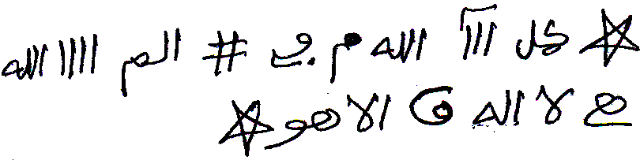

# TRANSKRIPSI LENGKAP — الأسماء الطمطمية

**Sumber:** `asmak thomthomiyah.pdf` — Google Drive `1XWBvZ991eBsU1sgdugrMkhzb7o_yeA1m`
**Jumlah halaman:** 12 hal. PDF (A4) · **Tanggal transkripsi:** 5 November 2026 · **Cabang:** `arena/dc140e9f-kitab`
**Pengaturan mengikat:** `KUNCI_PERMANEN_USTADZ_YOAD.md` (§4 Aturan Khusus Kitab Hikmah)

> **Peringatan editorial.** Ini adalah transkripsi dokumenter naskah tradisi hikmah/ruhaniyyah. Klaim khasiat, penyembuhan, penundukan, dan perkara gaib di dalamnya adalah **isi naskah**, bukan bukti medis, bukan anjuran amal, dan bukan jaminan hasil. Penelaahan ahli bahasa Arab dan penyunting naskah tetap diperlukan sebelum penerbitan.
>
> **Permintaan kali ini = transkrip lengkap**, bukan bedah 10 langkah. Kunci permanen tetap dipakai untuk **muhafazhah**: azimah, asma', thilasm, dan angka wafaq dijaga apa adanya, tidak diterjemahkan dan tidak dilatinisasi.

---

## 0. IDENTIFIKASI JENIS TEKS (§4.1 kunci permanen)

| Kategori | Ada? | Bukti dalam naskah | Perlakuan |
|---|---|---|---|
| **(a) Syarah / penjelasan** | Ya | Muqaddimah hal. 1, kaifiyat tiap خاتم, jadwal hari & waktu hal. 11–12, syarat «ولابد لمن أراد استعماله بالتقوى» | Di-i'rab dan diterjemahkan **terbatas** pada tata cara, waktu, hari, بخور, dan syarat (§4.3) |
| **(b) Azimah / Wafaq / Thilasm / Asma' / Mantra** | Ya | الاسم الكبير طمطكطجيشمحمدأل, 14 asma', 15 kotak wafaq 3×3, thilasm tulis tangan hal. 2, lafaz تبخ بخ بخ هيسون, دلدل طد ندكم | **[TEKS ASLI DIJAGA - TIDAK DITERJEMAH KARENA THILASM/WAFAQ]** |

**Mazhab:** `Al-Muhafazhatu 'ala al-Qadimi as-Shalih` — rasm, harakat seadanya, varian ejaan asma', dan angka Arab wafaq tidak dinormalisasi.

---

## 1. TEKS ARAB ASLI (MUHAFAZHAH — BIARKAN)

Arah baca RTL. Judul berwarna merah/hijau/ungu pada PDF ditandai dengan keterangan dalam kurung siku. Angka ditulis persis sebagaimana tampil di halaman.

### HAL 01 — Sampul / Muqaddimah

```text
شيخ الروحانيين الشيخ عطية عبد الحميد للمتابعة والكشف الروحاني        [baris biru-hitam]
٠٠٢٠١٠٦٢٠٢٢٢٣٨                                                      [baris ungu]
الأسماء الطمطمية أسماء آصف ابن برخيا وكيفية العمل بيها                [judul merah]
```

```text
بسم الله الملك الحق المبين الرحمن الرحيم

اللهم صلى على سيدنا محمد الحبيب المحبوب شافي العلل ومفرج الكروب وعلى اله وصحبه وسلم صلاة ترضيك يا الله وترضية وترضى بها عنى يا رب العالمين آمين آمين آمين

هذه الأسماء لها أسرار عظيمة ومجربة من مجرباتي شيخ الروحانيين الشيخ عطية عبد الحميد وأحببت أن أضعها لكل محبي هذا العلم حتى لا يبخل علينا بالدعاء وهذه الأسماء خاصة بالسيد اصف ابن برخيا وسميت باسم أسماء اصف وها هي بين أيديكم ألان
```

```text
الأسماء الطمطمية                                                      [judul merah]

هذه هي الأسماء الطمطمية عظيمة جدا فمن أراد أن يحبه الناس ويوقروه ويبجلوه ويعظموه ويسمعوا كلامه ويطيعوا أوامره فليكتب الخاتم السليمانى ويكتب حوله الأسماء كلها مرة والاسم الكبير ٨٧ مرة ويمحيها ويغسل بيه وجهه وكبه في ماء شربهم أو في مأكلهم فانه يكون بإذن الله تعالى وهذا الخاتم
```

### HAL 02 — Daftar Asma'

**[TEKS ASLI DIJAGA - TIDAK DITERJEMAH KARENA THILASM/WAFAQ]** — thilasm tulis tangan di kepala halaman (satu gambar, tidak dialih-aksarakan):



```text
والاسم الكبير هو هذا

طمطكطجيشمحمدأل

والأسماء الأربعة عشر هي هذه

١- طشر موشش   ٢- مهرش الش   ٣- طفطنطفش   ٤- كويش ظرخ
٥- طمخ طميخ   ٦- جفنض لمخ   ٧- يرة بزيخ   ٨- شوكج بجخ
٩- مذطص جبخ  ١٠- حشتم دمخ  ١١- مظهر شمخ  ١٢- ديوم شلش
١٣- ارخ شمرخ  ١٤- لمخ شدمخ

تمت بحمد الله وعونه

واليك جداولها وكلها صحيحة الوضع
```

### HAL 03 — خاتم الاسم الأول · خاتم الاسم الثاني

```text
خاتم الاسم الأول                                                      [judul merah]
طشر موشش
يذكر عدد ٧٨٧ مع الم الله لا اله إلا هو عدد ٧٧ على ماء ويرش به وجه المريض فيبرا حينه إن شاء الله
```

**[TEKS ASLI DIJAGA - TIDAK DITERJEMAH KARENA THILASM/WAFAQ]** — وفق ٣×٣ no. 1:

<table dir="rtl" style="text-align:center">
<tr><td>١</td><td>٣٢٥١</td><td>٣</td></tr>
<tr><td>٥</td><td>اسم<br>المريض</td><td>٣٢٥٠</td></tr>
<tr><td>٣٢٤٩</td><td>٤</td><td>٢</td></tr>
</table>

```text
خاتم الاسم الثاني                                                     [judul merah]
مهرش الش
يذكر عدد ٧٧ مرة مع الم الله لا اله إلا هو ٨٢٨ لكل حاجة تقضى بإذن الله
```

**[TEKS ASLI DIJAGA - TIDAK DITERJEMAH KARENA THILASM/WAFAQ]** — وفق ٣×٣ no. 2 (baris 3 secara fisik tercetak di hal. 04):

<table dir="rtl" style="text-align:center">
<tr><td>١</td><td>٢٢٧٢</td><td>٣</td></tr>
<tr><td>٥</td><td>اسم<br>الحاجة</td><td>٢٢٧١</td></tr>
<tr><td>٢٢٧٠</td><td>٤</td><td>٢</td></tr>
</table>

### HAL 04 — lanjutan no. 2 · خاتم الاسم الثالث · خاتم الاسم الرابع

```text
٢٢٧٠ | ٤ | ٢                    [lanjutan baris 3 وفق no. 2 — sudah disajikan lengkap di hal. 03]
```

```text
خاتم الاسم الثالث                                                     [judul merah]
طفطنطفش
يذكر بدون عدد لرد الضالة أو المسروق مع كتابه اسم الضالة وسط الخاتم حرز يوضع في المحل
```

**[TEKS ASLI DIJAGA - TIDAK DITERJEMAH KARENA THILASM/WAFAQ]** — وفق ٣×٣ no. 3:

<table dir="rtl" style="text-align:center">
<tr><td>١</td><td>١٢٧٣</td><td>٣</td></tr>
<tr><td>٥</td><td>اسم<br>المسروق</td><td>١٢٧٢</td></tr>
<tr><td>١٢٧١</td><td>٤</td><td>٢</td></tr>
</table>

```text
خاتم الاسم الرابع                                                     [judul merah]
كويش ظرخ
يذكر عدد ٤١ مع الفاتحة كذالك على مجنون ثلاث أيام مع كتابه الخاتم حرز يتبخر به ثلاث ليالي يبرا بحول الله وقوته
```

**[TEKS ASLI DIJAGA - TIDAK DITERJEMAH KARENA THILASM/WAFAQ]** — وفق ٣×٣ no. 4 (baris 3 secara fisik tercetak di hal. 05):

<table dir="rtl" style="text-align:center">
<tr><td>١</td><td>٢٦٣٢</td><td>٣</td></tr>
<tr><td>٥</td><td>اسم<br>المجنون</td><td>٢٦٣١</td></tr>
<tr><td>٢٦٣٠</td><td>٤</td><td>٢</td></tr>
</table>

### HAL 05 — lanjutan no. 4 · خاتم الاسم الخامس · خاتم الاسم السادس

```text
٢٦٣٠ | ٤ | ٢                    [lanjutan baris 3 وفق no. 4 — sudah disajikan lengkap di hal. 04]
```

```text
خاتم الاسم الخامس                                                     [judul merah]
طمخ طميخ
يقرا بعد ما كتب عليها هذه الأحرف
دلدل طد ندكم مع كتابه الخاتم واسمه في الوسط فيبخر به ثلاث ليال فيبرأ إن شاء الله
```

**[TEKS ASLI DIJAGA - TIDAK DITERJEMAH KARENA THILASM/WAFAQ]** — lafaz `دلدل طد ندكم` dan وفق ٣×٣ no. 5:

<table dir="rtl" style="text-align:center">
<tr><td>١</td><td>١٣٠٤</td><td>٣</td></tr>
<tr><td>٥</td><td>الاسم</td><td>١٣٠٣</td></tr>
<tr><td>١٣٠٢</td><td>٤</td><td>٢</td></tr>
</table>

```text
خاتم الاسم السادس                                                     [judul merah]
جفض لمخ
يقرا هذا الاسم مع الآية والله يعصمك من الناس ١٦١ مع كتابه الخاتم واسمك في الوسط ويمحى وتغتسل أو تشربه تنجو من الناس وأفعالهم
```

### HAL 06 — lanjutan no. 6 · خاتم الاسم السابع · kepala خاتم الاسم الثامن

**[TEKS ASLI DIJAGA - TIDAK DITERJEMAH KARENA THILASM/WAFAQ]** — وفق ٣×٣ no. 6:

<table dir="rtl" style="text-align:center">
<tr><td>١</td><td>٩٠٩</td><td>٣</td></tr>
<tr><td>٥</td><td>اسمك</td><td>٩٠٨</td></tr>
<tr><td>٩٠٧</td><td>٤</td><td>٢</td></tr>
</table>

```text
خاتم الاسم السابع                                                     [judul merah]
يرة بريخ
هذا الاسم من تلاه مع الآية الم الله لا اله إلا هو عدد ٧٧ مرة بنية الاستخارة ونام شهد ما بين العرش والفرش إن شاء الله
```

**[TEKS ASLI DIJAGA - TIDAK DITERJEMAH KARENA THILASM/WAFAQ]** — وفق ٣×٣ no. 7:

<table dir="rtl" style="text-align:center">
<tr><td>١</td><td>٨٣٠</td><td>٣</td></tr>
<tr><td>٥</td><td>اسم<br>المسروق</td><td>٨٢٩</td></tr>
<tr><td>٨٢٨</td><td>٤</td><td>٢</td></tr>
</table>

```text
خاتم الاسم الثامن                                                     [judul merah]
شوكج بجخ
```

### HAL 07 — lanjutan no. 8 · خاتم الاسم التاسع

```text
من تلاه ٧٠ مرة مع هذه الآية خذوه فغلوه ثم الجحيم صلوه الـــى فاسلكوه على تراب ورماة في دار عدوه نقص ماله وتقطعت أوصاله إن شاء الله
```

**[TEKS ASLI DIJAGA - TIDAK DITERJEMAH KARENA THILASM/WAFAQ]** — وفق ٣×٣ no. 8:

<table dir="rtl" style="text-align:center">
<tr><td>١</td><td>١٦٣٠</td><td>٣</td></tr>
<tr><td>٥</td><td>اسم<br>العدو</td><td>١٦٢٩</td></tr>
<tr><td>١٦٢٨</td><td>٤</td><td>٢</td></tr>
</table>

```text
خاتم الاسم التاسع                                                     [judul merah]
مذطص جفخ
من تلاه مع البسملة مكتوبة ٦١ مرة وعلقها على شجرة أمطر ذالك البلد بإذن الله
```

**[TEKS ASLI DIJAGA - TIDAK DITERJEMAH KARENA THILASM/WAFAQ]** — وفق ٣×٣ no. 9:

<table dir="rtl" style="text-align:center">
<tr><td>١</td><td>١٤٨٨</td><td>٣</td></tr>
<tr><td>٥</td><td>اسم<br>البلد</td><td>١٤٨٧</td></tr>
<tr><td>١٤٨٦</td><td>٤</td><td>٢</td></tr>
</table>

### HAL 08 — خاتم الاسم العاشر · خاتم الاسم الحادي عشر

```text
خاتم الاسم العاشر                                                     [judul merah]
حشتم دمخ
من كتبه حول المثلث في لوح نحاس احمر ووضعه في الشمس مع اسم الشخص المراد تسخيره سخرة الله له إن شاء الله
```

**[TEKS ASLI DIJAGA - TIDAK DITERJEMAH KARENA THILASM/WAFAQ]** — وفق ٣×٣ no. 10:

<table dir="rtl" style="text-align:center">
<tr><td>١</td><td>٢٠٨٨</td><td>٣</td></tr>
<tr><td>٥</td><td>اسم<br>الشخص</td><td>٢٠٨٧</td></tr>
<tr><td>٢٠٨٦</td><td>٤</td><td>٢</td></tr>
</table>

```text
خاتم الاسم الحادي عشر                                                 [judul merah]
مظهر شمخ
من كتبه سبع مرات حول الخاتم مع أسماء أهل الكهف وتلا عليهم هذه الآية أومن كان ميتا فأحييناه الـــى زين سبع مرات ومحاه وغسل به وجهه ويديه وخرج للسفر فانه يرجع برزق وافر إن شاء الله
```

**[TEKS ASLI DIJAGA - TIDAK DITERJEMAH KARENA THILASM/WAFAQ]** — وفق ٣×٣ no. 11 (baris 3 secara fisik tercetak di hal. 09):

<table dir="rtl" style="text-align:center">
<tr><td>١</td><td>٢٦٨١</td><td>٣</td></tr>
<tr><td>٥</td><td>الحاجة</td><td>٢٦٨٠</td></tr>
<tr><td>٢٦٧٩</td><td>٤</td><td>٢</td></tr>
</table>

### HAL 09 — lanjutan no. 11 · خاتم الاسم الثاني عشر · خاتم الاسم الثالث عشر

```text
٢٦٧٩ | ٤ | ٢                    [lanjutan baris 3 وفق no. 11 — sudah disajikan lengkap di hal. 08]
```

```text
خاتم الاسم الثاني عشر                                                 [judul merah]
ديوم شلش
من كتبه مقطعة الحروف مع وحملناه على ذات ألواح ودسر تجرى بأعيننا حول الخاتم في نحاس احمر ولصقه على سفينة فإنا لا تغرق مهما كبرت الأمواج إن شاء الله
```

**[TEKS ASLI DIJAGA - TIDAK DITERJEMAH KARENA THILASM/WAFAQ]** — وفق ٣×٣ no. 12:

<table dir="rtl" style="text-align:center">
<tr><td>١</td><td>٢٠٨٦</td><td>٣</td></tr>
<tr><td>٥</td><td>الحاجة</td><td>٢٠٨٥</td></tr>
<tr><td>٢٠٨٤</td><td>٤</td><td>٢</td></tr>
</table>

```text
خاتم الاسم الثالث عشر                                                 [judul merah]
ارخ شمرخ
من كتبه مع قوله ولو أرادوا الخروج الـــى القاعدين في شقفه ورماها في البحر لا تسير فيه مركب إلا وغرقت بمشيئة الله تعالى
```

**[TEKS ASLI DIJAGA - TIDAK DITERJEMAH KARENA THILASM/WAFAQ]** — وفق ٣×٣ no. 13 (baris 2–3 secara fisik tercetak di hal. 10; sel tengah baris 2 kosong):

<table dir="rtl" style="text-align:center">
<tr><td>١</td><td>٢٦٣٧</td><td>٣</td></tr>
<tr><td>٥</td><td>&nbsp;</td><td>٢٦٣٦</td></tr>
<tr><td>٢٦٣٥</td><td>٤</td><td>٢</td></tr>
</table>

### HAL 10 — lanjutan no. 13 · خاتم الاسم الرابع عشر · خاتم الاسم الكبير

```text
٥ | (kosong) | ٢٦٣٦   /   ٢٦٣٥ | ٤ | ٢    [lanjutan baris 2–3 وفق no. 13 — sudah disajikan lengkap di hal. 09]
```

```text
خاتم الاسم الرابع عشر                                                 [judul merah]
لنخ شدمخ
من ذكره في موضع خال شاهد الجن بعينه مع كتابه المثلث وحاجته في البيت الخالي وغسل وجهه نال ما ذكر إن شاء الله
```

**[TEKS ASLI DIJAGA - TIDAK DITERJEMAH KARENA THILASM/WAFAQ]** — وفق ٣×٣ no. 14:

<table dir="rtl" style="text-align:center">
<tr><td>١</td><td>٢٣١٠</td><td>٣</td></tr>
<tr><td>٥</td><td>الحاجة</td><td>٢٣٠٩</td></tr>
<tr><td>٢٣٠٨</td><td>٤</td><td>٢</td></tr>
</table>

```text
خاتم الاسم الكبير                                                     [judul merah]
```

**[TEKS ASLI DIJAGA - TIDAK DITERJEMAH KARENA THILASM/WAFAQ]** — lafaz الاسم الكبير berikut dua glyph hias yang mengapitnya di naskah:


```text
طمطكطجيشمحمدأل
من ذكره ١٤ مرة وذكر الاسم الآتي عدد ٣١٣ مرة والاسم هو هذا
```

### HAL 11 — خاتم الاسم الكبير · Keterangan · Awal jadwal

**[TEKS ASLI DIJAGA - TIDAK DITERJEMAH KARENA THILASM/WAFAQ]**

```text
تبخ بخ بخ هيسون ومن ذكرة سبع مرات مع قوله تعالى قالوا يا لوط إنا رسل ربك لن يصلون إليك على وجه من يكره فانه لا يأتيه ابد
```

**[TEKS ASLI DIJAGA - TIDAK DITERJEMAH KARENA THILASM/WAFAQ]** — وفق ٣×٣ no. 15 (الاسم الكبير):

<table dir="rtl" style="text-align:center">
<tr><td>١١</td><td>١١٧٩</td><td>٣٣</td></tr>
<tr><td>٥٥</td><td>الاسم</td><td>١١٦٨</td></tr>
<tr><td>١١٥٧</td><td>٤٤</td><td>٢٢</td></tr>
</table>

```text
واعلم أن هذه الأسماء مستخرجة من الجلجلوتيه وهى صحيحة مجربة نفعنا الله بها            [baris hijau]

وهذا الاسم هو الذي كان به سليمان بن داود يفعل به المعجزات وملك به الجن والريح والطير وأعطى شيئا من سره لآصف بن برخيا و الجن الذي عنده علم من الكتاب ولابد لمن أراد استعماله بالتقوى وهو

طمطكطجيشمحمدأل

وهو أربعة عشر حرف من أراد العمل به فليذكره بعد كل فرض ١٤ مرة والأسماء ٧٧ مرة كالتالي طشرموشش ٧٧ مرة ليله الأحد بعد نوم الناس

مهرش الش قبل طلوع الشمس من يوم الأحد ٧٧ مرة
```

### HAL 12 — Jadwal hari & waktu · Penutup

```text
طفطنطفش ٧٧ مرة ليله الاثنين
كويش ظرخ ٧٧ مرة قبل طلوع شمس الاثنين أو وقت الضحى
طمخ طميخ ٧٧ مرة ليله الثلاثاء
جفنض لمخ ٧٧ مرة وقت الزوال من يوم الثلاثاء
يرة بزيخ ٧٧ مرة ليله الأربع
شوكج بجخ يوم الأربعاء وقت الظهر
مذطص جفخ ٧٧ مرة ليله الخميس
حشتم دمخ ٧٧ مرة بين الظهر والعصر من الخميس
مظهر شمخ ٧٧ مرة ليله الجمعة
ديوم شلش ٧٧ مرة بعد عصر يوم الجمعة
ارخ شمرخ ٧٧ مرة بعد مغرب يوم السبت
لمخ شدمخ ٧٧ مرة ليله السبت

اللهم صل على سيدنا محمد الفاتح الخاتم وعلى اله حق قدرة ومقدرة العظيم
```

---

## 2. I'ROB FUSHA (JIKA SYARAH)

I'rab hanya untuk bagian **syarah/kaifiyat**. Asma', azimah, dan isi kotak وافق **tidak** di-i'rab dan tidak diterjemahkan.

| Lafaz (dari syarah) | I'rab |
|---|---|
| هَذِهِ الْأَسْمَاءُ | هَذِهِ : مُبْتَدَأٌ مَرْفُوعٌ بِالضَّمَّةِ (ism isyarah, mabni 'ala dhamm); الْأَسْمَاءُ : بَدَلٌ / عَطْفُ بَيَانٍ مَرْفُوعٌ بِالضَّمَّةِ |
| لَهَا أَسْرَارٌ عَظِيمَةٌ | لَهَا : خَبَرٌ مُقَدَّمٌ لِـ «أَسْرَارٌ» (جَارٌّ وَمَجْرُورٌ) · أَسْرَارٌ : مُبْتَدَأٌ مُؤَخَّرٌ مَرْفُوعٌ بِالضَّمَّةِ · عَظِيمَةٌ : نَعْتٌ مَرْفُوعٌ — **pola Langkah 4** |
| وَيَكْتُبُ حَوْلَهُ الْأَسْمَاءَ | وَ : حَرْفُ عَطْفٍ · يَكْتُبُ : فِعْلٌ مُضَارِعٌ مَرْفُوعٌ بِالضَّمَّةِ، فَاعِلُهُ ضَمِيرٌ مُسْتَتِرٌ · الْأَسْمَاءَ : مَفْعُولٌ بِهِ مَنْصُوبٌ بِالْفَتْحَةِ — **Langkah 6A, 7, 8** |
| فَلْيَكْتُبِ الْخَاتَمَ السُّلَيْمَانِيَّ | الْفَاءُ : فَصِيحَةٌ / عَاطِفَةٌ · اللَّامُ : لَامُ الْأَمْرِ · يَكْتُبِ : فِعْلٌ مُضَارِعٌ مَجْزُومٌ بِالسُّكُونِ · الْخَاتَمَ : مَفْعُولٌ بِهِ مَنْصُوبٌ · السُّلَيْمَانِيَّ : نَعْتٌ مَنْصُوبٌ |
| فِي لَوْحِ نَحَاسٍ أَحْمَرَ | فِي : حَرْفُ جَرٍّ · لَوْحِ : مَجْرُورٌ بِـ فِي وَهُوَ مُضَافٌ · نَحَاسٍ : مُضَافٌ إِلَيْهِ مَجْرُورٌ بِالكَسْرَةِ · أَحْمَرَ : نَعْتٌ مَجْرُورٌ بِالْفَتْحَةِ نِيَابَةً عَنِ الْكَسْرَةِ (مَمْنُوعٌ مِنَ الصَّرْفِ) — **Langkah 10** |
| يُذْكَرُ عَدَدَ ٤١ مَعَ الْفَاتِحَةِ | يُذْكَرُ : فِعْلٌ مُضَارِعٌ مَبْنِيٌّ لِلْمَجْهُولِ مَرْفُوعٌ · عَدَدَ : ظَرْفُ / تَمْيِيزٌ مَنْصُوبٌ · مَعَ : ظَرْفٌ مَنْصُوبٌ وَهُوَ مُضَافٌ · الْفَاتِحَةِ : مُضَافٌ إِلَيْهِ مَجْرُورٌ بِالكَسْرَةِ |
| ثَلَاثَ لَيَالٍ | ظَرْفُ زَمَانٍ مَنْصُوبٌ بِالْفَتْحَةِ (مُضَافٌ: لَيَالٍ مُضَافٌ إِلَيْهِ) — **bentuk jamak Langkah 9** |
| وَلَابُدَّ لِمَنْ أَرَادَ اسْتِعْمَالَهُ بِالتَّقْوَى | لَابُدَّ : خَبَرٌ مُقَدَّمٌ لِـ «مِنَ التَّقْوَى» المقدَّر · لِمَنْ : جَارٌّ وَمَجْرُورٌ · أَرَادَ : فِعْلٌ مَاضٍ، فَاعِلُهُ ضَمِيرٌ مُسْتَتِرٌ · اسْتِعْمَالَهُ : مَفْعُولٌ بِهِ مَنْصُوبٌ + ضَمِيرٌ مُتَّصِلٌ فِي مَحَلِّ نَصْبٍ مُضَافٌ إِلَيْهِ |

---

## 3. TERJEMAH SYARAH (FUSHA)

Sesuai §4.3 kunci permanen: **hanya** tata cara (kaifiyat), waktu, hari, بخور, dan syarat yang diterjemahkan. Nama-nama asma' tetap ditulis dalam Arab apa adanya. Klaim hasil diterjemahkan sebagai *pernyataan naskah*, bukan sebagai fakta.

1. **Hal. 1 (muqaddimah & kaifiyat umum).** Penulis menyebut ini himpunan nama dengan rahasia besar yang sudah dicoba, khusus untuk السيد آصف ابن برخيا, dan ia meletakkannya untuk para pencinta ilmu ini agar mereka tidak pelit mendoakannya. Kemudian: barangsiapa menghendaki orang-orang mencintai, memuliakan, mengagungkan, mendengar ucapannya, dan menaati perintahnya, hendaklah ia menulis **خاتم** Sulaimani, menuliskan seluruh nama di sekelilingnya satu kali dan **الاسم الكبير** ٨٧ kali, lalu menghapusnya, membasuh wajah dengannya, dan menuangkannya ke dalam air minum mereka atau makanan mereka; menurut naskah, hal itu terjadi dengan izin Allah Ta'ala.
2. **Hal. 3 (no. 1).** Dibaca sebanyak ٧٨٧ bersama «الم الله لا اله إلا هو» dan ٧٧ kali di atas air, lalu dipercikkan ke wajah orang sakit; menurut naskah ia sembuh saat itu juga, insyaAllah.
3. **Hal. 3 (no. 2).** Dibaca ٧٧ kali bersama «الم الله لا اله إلا هو» dan bilangan ٨٢٨ untuk setiap hajat yang dipenuhi dengan izin Allah.
4. **Hal. 4 (no. 3).** Dibaca tanpa hitungan untuk mengembalikan barang hilang atau curi, dengan menuliskan nama barang hilang itu di tengah **خاتم**; sebagai **حرز** yang diletakkan di tempatnya.
5. **Hal. 4 (no. 4).** Dibaca ٤١ kali bersama al-Fatihah, demikian pula untuk orang gila selama tiga hari, dengan menuliskan **خاتم** sebagai **حرز**, lalu **diasapi (بخور)** dengannya selama tiga malam; menurut naskah sembuh dengan daya dan kekuatan Allah.
6. **Hal. 5 (no. 5).** Dibaca setelah dituliskan huruf-huruf `دلدل طد ندكم`, bersama penulisan **خاتم** dan nama di tengahnya, lalu **diasapi (بخور)** selama tiga malam; menurut naskah sembuh, insyaAllah.
7. **Hal. 5 (no. 6).** Dibaca bersama ayat «والله يعصمك من الناس» dan bilangan ١٦١, dengan menuliskan **خاتم** serta namamu di tengah, lalu dihapus, dipakai mandi atau diminum; menurut naskah selamat dari manusia dan perbuatan mereka.
8. **Hal. 6 (no. 7).** Dibaca ٧٧ kali bersama ayat «الم الله لا اله إلا هو» dengan niat **istikharah**, lalu tidur; menurut naskah ia menyaksikan apa yang antara Arasy dan Farasy, insyaAllah.
9. **Hal. 7 (no. 8).** Dibaca ٧٠ kali bersama ayat «خذوه فغلوه ثم الجحيم صلوه … إلى فاسلكوه», ditaruh pada tanah dan dilemparkan ke rumah musuhnya; menurut naskah hartanya berkurang dan anggota tubuhnya terputus, insyaAllah.
10. **Hal. 7 (no. 9).** Dibaca bersama basmalah yang ditulis ٦١ kali, lalu digantungkan pada pohon; menurut naskah negeri itu dituruni hujan dengan izin Allah.
11. **Hal. 8 (no. 10).** Ditulis di sekeliling segitiga pada lempengan tembaga merah, diletakkan di bawah matahari bersama nama orang yang dikehendaki **تسخير**-nya; menurut naskah Allah menundukkannya baginya, insyaAllah.
12. **Hal. 8 (no. 11).** Ditulis tujuh kali di sekeliling **خاتم** bersama nama-nama أهل الكهف, dibacakan ayat «أومن كان ميتا فأحييناه … إلى زين» tujuh kali, lalu dihapus, dibasuhkan ke wajah dan kedua tangan, kemudian keluar untuk bepergian; menurut naskah ia kembali dengan rezeki berlimpah, insyaAllah.
13. **Hal. 9 (no. 12).** Ditulis dengan huruf-huruf terpisah bersama «وحملناه على ذات ألواح ودسر تجرى بأعيننا» di sekeliling **خاتم** pada tembaga merah, lalu ditempelkan pada kapal; menurut naskah kapal itu tidak tenggelam betapapun besarnya ombak, insyaAllah.
14. **Hal. 9 (no. 13).** Ditulis bersama «ولو أرادوا الخروج … إلى القاعدين» pada pecahan, lalu dilemparkan ke laut; menurut naskah tiada perahu yang berlayar di sana melainkan tenggelam, dengan kehendak Allah Ta'ala.
15. **Hal. 10 (no. 14).** Dibaca di tempat yang sepi; menurut naskah jin dapat disaksikan dengan mata, bersama penulisan segitiga dan hajat di rumah yang kosong, lalu wajah dibasuh; ia memperoleh apa yang disebutkan, insyaAllah.
16. **Hal. 10–11 (الاسم الكبير & syarat).** Dibaca ١٤ kali, lalu nama berikutnya ٣١٣ kali. Penulis menyatakan nama-nama ini digali dari **الجلجلوتيه**, shahih dan sudah dicoba. Disebutkan pula bahwa nama itu dipakai Sulaiman bin Dawud untuk mukjizat, menundukkan jin, angin, dan burung, serta sebagian rahasianya diberikan kepada آصف بن برخيا. **Syarat yang ditekankan:** «ولابد لمن أراد استعماله بالتقوى» — siapa yang hendak memakainya wajib dengan takwa. Nama itu terdiri dari empat belas huruf; diamalkan ١٤ kali setiap selesai shalat fardhu, dan nama-nama lainnya ٧٧ kali.
17. **Hal. 11–12 (jadwal hari & waktu).** Terjemahan operasional jadwal, dengan **asma' tetap dijaga**:

| Asma' (dijaga) | Hitungan | Waktu / hari menurut naskah |
|---|---|---|
| طشرموشش | ٧٧ | Malam Ahad, setelah orang-orang tidur |
| مهرش الش | ٧٧ | Sebelum terbit matahari hari Ahad, atau waktu dhuha |
| طفطنطفش | ٧٧ | Malam Senin |
| كويش ظرخ | ٧٧ | Sebelum terbit matahari Senin, atau waktu dhuha |
| طمخ طميخ | ٧٧ | Malam Selasa |
| جفنض لمخ | ٧٧ | Waktu zawal (tergelincir matahari), hari Selasa |
| يرة بزيخ | ٧٧ | Malam Rabu |
| شوكج بجخ | — (tidak tercantum di naskah) | Hari Rabu, waktu dzuhur |
| مذطص جفخ | ٧٧ | Malam Kamis |
| حشتم دمخ | ٧٧ | Antara dzuhur dan ashar, hari Kamis |
| مظهر شمخ | ٧٧ | Malam Jumat |
| ديوم شلش | ٧٧ | Setelah ashar hari Jumat |
| ارخ شمرخ | ٧٧ | Setelah maghrib hari Sabtu |
| لمخ شدمخ | ٧٧ | Malam Sabtu |

18. **Hal. 12 (penutup).** Doa shalawat penutup: «اللهم صل على سيدنا محمد الفاتح الخاتم وعلى اله حق قدرة ومقدرة العظيم» — **dijaga sebagai lafaz doa, tidak diterjemahkan bebas**.

---

## 4. CATATAN HIKMAH

> **Catatan Hikmah: Ini adalah Thilasm/Wafaq/Asma' yang dijaga.**

- **15 kotak وافق ٣×٣** (14 khātam + خاتم الاسم الكبير) seluruhnya disalin dengan angka Arab-Indik asli; tidak ada angka yang diubah, dikonversi ke Latin, atau "dibetulkan" jumlahnya.
- **Thilasm tulis tangan hal. 02** dan **dua glyph hias yang mengapit الاسم الكبير hal. 10** disimpan sebagai facsimile gambar (`assets/`), bukan dialih-aksarakan, karena bacaannya tidak dapat dipastikan.
- **[TEKS ASLI DIJAGA - TIDAK DITERJEMAH KARENA THILASM/WAFAQ]** berlaku untuk: `طمطكطجيشمحمدأل`, ke-14 asma', `تبخ بخ بخ هيسون`, `دلدل طد ندكم`, seluruh isi kotak وافق, dan thilasm gambar.
- **Kamus istilah hikmah (§4.4):** kata **خاتم** (seluruh judul «خاتم الاسم…»), **وفق** (kotak angka), dan akar **بخور** (`يتبخر به`, `فيبخر به`) → **Istilah Falak/Hikmah**; tidak diterjemahkan secara bebas, dipertahankan dalam Arab dengan keterangan operasional terbatas. Istilah **تسخير**, **الجن**, **حرز**, **الجلجلوتيه**, **أهل الكهف** juga dipertahankan sebagai istilah teknis naskah. Kata زحل، مشتري، عطارد، طلسم، توكيل، خادم tidak ditemukan dalam naskah ini.
- Ayat-ayat Al-Qur'an yang dikutip sebagian (dengan tanda `الـــى` = *ilā*) dibiarkan apa adanya; transkripsi tidak melengkapi atau membetulkan kutipan.

---

## 5. CATATAN KOLASI / RASM (EDITORIAL)

1. **Lapis teks PDF bukan teks siap pakai.** PDF memakai *Arabic Presentation Forms* dan ligatur PUA; `get_text()` menghasilkan kata terpenggal (`الأ` + `سماء`, `ال` + `طمطمية`) dan **urutan angka terbalik** terhadap tampilan. Transkripsi ini disusun dari (a) posisi glyph per karakter, (b) render 12 halaman 150–1200 DPI, dan (c) kontrol silang baris-baris yang bersambung antar halaman. **Pemenggalan baris tipografis** (mis. judul «…وكيفية العمل / بيها» yang turun satu baris, atau «الاسم / السابع») dirapikan menjadi paragraf; urutan kata tidak diubah. Baris yang benar-benar bersambung antar halaman tetap ditandai.
2. **Angka:** string yang terekstrak dibalik ke urutan tampil LTR, lalu ditulis kembali sebagaimana terlihat di halaman. Contoh: terekstrak `٧٨` → tampil `٨٧`; `٠١` → `١٠`; `٤١` → `١٤` (hal. 10/11), sedangkan `١٤` → `٤١` (hal. 4); `١٦` → `٦١` (hal. 7); nomor kontak `٨٣٢٢٢٠٢٦٠١٠٢٠٠` → `٠٠٢٠١٠٦٢٠٢٢٢٣٨`.
3. **Ligatur ﷲ:** lapis teks memunculkan `االله` (alif + ligatur). Rasm visual jelas `الله`; transkripsi mengikuti rasm visual. Ini koreksi artefak glyph, bukan perubahan lafaz.
4. **Rasm tidak dinormalisasi:** `ألان` (= الآن), `كذالك`, `فانه`, `بيه`, `يقرا`, `ذالك`, `اله`, `واليك`, `احمر`, `السليمانى`, `تجرى`, `وهى`, `فإنا` (bentuk kata ini samar pada ligatur, dipertahankan sesuai rasm), `ابد`, `ورماة`, `كبه`, `شربهم`, `شقفه`, `ليله` (dengan ه, bukan ة), `الجلجلوتيه` (dengan ه) — semua dibiarkan sebagaimana tercetak. `الـــى` dengan garis panjang dipertahankan sebagai penanda *ilā* naskah.
5. **Varian asma' antar-bagian (dijaga, tidak disamakan):**

| Daftar hal. 02 | Judul/jadwal | Keterangan |
|---|---|---|
| جفنض لمخ | جفض لمخ (hal. 05), جفنض لمخ (hal. 12) | varian ن |
| يرة بزيخ | يرة بريخ (hal. 06), يرة بزيخ (hal. 12) | varian ز/ر |
| مذطص جبخ | مذطص جفخ (hal. 07, 12) | varian ب/ف |
| لمخ شدمخ | لنخ شدمخ (hal. 10), لمخ شدمخ (hal. 12) | varian م/ن |
| آصف / اصف | آصف / اصف (hal. 01, 11) | varian hamzah |
| طشر موشش | طشرموشش (hal. 11, disambung) | varian penyambungan |
| طفطنطفش | طفطنطفش (hal. 12) | konsisten |

6. **Baris 3 وافق yang terpotong halaman** (no. 2, 4, 11, 13) disajikan lengkap pada halaman awalnya dengan catatan asal fisik baris; pada halaman lanjutan hanya dicantumkan penanda, agar tidak terjadi duplikasi angka.
7. **Sel kosong** pada baris 2 وافق no. 13 (hal. 10) sengaja dibiarkan kosong, bukan diisi «الحاجة» seperti وافق lainnya.
8. **Baris tanpa hitungan** «شوكج بجخ يوم الأربعاء وقت الظهر» (hal. 12) sengaja dibiarkan tanpa ٧٧, sesuai naskah.
9. **Warna** (merah = judul خاتم/الأسماء الطمطمية, hijau = «واعلم أن…», ungu = nomor kontak, biru = nama syaikh) dicatat sebagai keterangan, tidak mengubah teks.
10. **Batas verifikasi:** ini transkripsi bentuk huruf dan angka dari PDF, **bukan** pensahihan harakat, sanad, hukum fiqh, atau khasiat. Untuk penerbitan diperlukan kolasi dengan naskah tangan/cetak asli.
